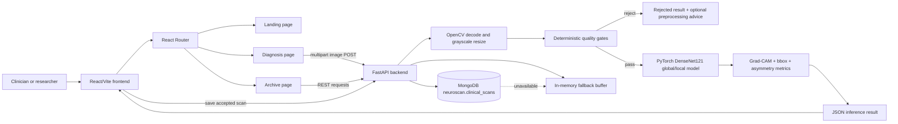
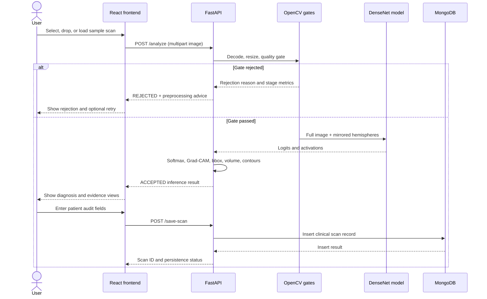

# NeuroScan Project Documentation

## 1. Project Summary

NeuroScan is a local clinical decision-support prototype for brain CT image triage. It combines:

- A React/Vite web interface for scan ingestion, staged quality-gate visualization, classification, explainability, and archive management.
- A FastAPI backend that performs image decoding, deterministic quality checks, optional preprocessing, DenseNet121-based inference, Grad-CAM generation, lesion geometry estimation, and persistence.
- A PyTorch model checkpoint stored locally in `backend/model_weights/`.
- MongoDB persistence with an in-memory fallback when MongoDB is unavailable.
- A bundled five-class CT dataset and an IEEE-style research paper describing the intended method.

This repository is a research/demo system. It should not be treated as a regulated diagnostic device or as a substitute for qualified radiologist review.

## 2. Repository Layout

```text
base_paper/
|-- backend/
|   |-- main.py                         FastAPI service, model, gates, preprocessing, persistence
|   |-- model_weights/
|   |   `-- neuroscan_densenet121_best.pth  PyTorch checkpoint
|   `-- mongodb_data/                   Local MongoDB WiredTiger data files
|
|-- frontend/
|   |-- package.json                    React/Vite dependencies and scripts
|   |-- vite.config.js                  Vite configuration
|   |-- tailwind.config.js              Theme, colors, fonts, animations
|   |-- postcss.config.js               PostCSS/Tailwind integration
|   |-- index.html                      Browser entry point and font imports
|   |-- public/
|   |   |-- human_brain.glb              Landing-page 3D model
|   |   |-- textures/                    Brain diffuse, normal, and specular textures
|   |   `-- sample_scans/                Preset UI scan inputs
|   `-- src/
|       |-- main.jsx                     React bootstrap
|       |-- App.jsx                      Router and global provider
|       |-- App.css                      Legacy Vite starter styles
|       |-- index.css                    Active global styles
|       |-- components/Header.jsx         Global navigation
|       |-- context/NeuroScanContext.jsx  Shared scan and archive state
|       `-- pages/
|           |-- Landing.jsx               3D landing page and feature navigation
|           |-- Diagnosis.jsx             Upload, gates, inference, overlays, save workflow
|           `-- Archive.jsx               Search, filter, inspect, and delete records
|
|-- NeuroVision-CT Dataset V-1.0/        Image dataset organized by split and class
|   |-- Training Set/
|   |-- Validation Set/
|   `-- Test Set/
|
|-- base paper/
|   |-- neuro_main_corrected.tex         IEEE research manuscript source
|   |-- neuro_main.pdf                   Compiled manuscript
|   |-- phase2 construction.jfif          Research architecture figure
|   |-- final_output.png                  Paper result figure
|   |-- graph correct output.png         Paper result graph
|   `-- reference_basepapers/             Referenced source papers
|
`-- PROJECT_DOCUMENTATION.md             This document
```

## 3. High-Level Architecture



### Runtime boundaries

| Boundary | Responsibility | Technology |
|---|---|---|
| Presentation | Navigation, uploads, telemetry, image overlays, archive controls | React 19, React Router, Tailwind CSS, Lucide, Three.js |
| API | Image upload, preprocessing, inference, explainability, persistence | FastAPI, Pydantic, Uvicorn-compatible ASGI |
| Vision | Decode, resize, segmentation, denoising, CLAHE, contours | OpenCV, NumPy |
| Neural inference | Four-class classification and activation extraction | PyTorch, torchvision DenseNet121 |
| Persistence | Clinical scan records and stored base64 evidence | MongoDB/PyMongo; in-memory fallback |
| Research artifacts | Methodology, figures, evaluation claims | LaTeX, PDF, PNG/JFIF figures |

## 4. Frontend Architecture

### 4.1 Bootstrap and routing

`frontend/src/main.jsx` mounts `App` under `React.StrictMode` and loads `index.css`.

`frontend/src/App.jsx` creates one `NeuroScanProvider`, then defines these routes:

| Route | Component | Purpose |
|---|---|---|
| `/` | `Landing` | 3D brain presentation, scanner launch, archive launch |
| `/diagnosis` | `Diagnosis` | Scan ingestion and inference workflow |
| `/archive` | `Archive` | Saved scan registry and patient audit view |

`Header.jsx` supplies persistent navigation and system-status presentation.

### 4.2 Shared state

`NeuroScanContext.jsx` stores:

- `currentScan`: object URL or public asset path for the active image.
- `inferenceResult`: latest backend response.
- `isInferencing`: active request state.
- `viewPlane`: axial, coronal, or sagittal display mode.
- `activeFilter` and `searchQuery`: archive filtering state.
- `registryRecords` and `selectedPatient`: reserved shared archive state; the current archive page primarily manages fetched records locally.

### 4.3 Landing page

`Landing.jsx` uses React Three Fiber and Drei to render `public/human_brain.glb` with:

- Anatomical, clinical teal, and wireframe material modes.
- Diffuse, normal, and specular textures.
- Orbit controls with automatic rotation.
- An animated CT-like laser ring and scan beam.
- Links to the Diagnosis and Archive workflows.

The page is a presentation surface. Its 3D scene does not perform medical inference.

### 4.4 Diagnosis workflow

The diagnosis page supports:

1. File selection and drag-and-drop.
2. Browser image preview.
3. Preset cohort loading from `frontend/public/sample_scans/`.
4. Standard inference through `POST /analyze`.
5. Optional preprocessing retry through `POST /analyze?preprocess=true`.
6. Animated stage display for tissue check, anatomy alignment, and contralateral analysis.
7. Four-view evidence presentation:
   - Raw CT slice.
   - Grad-CAM heatmap overlay.
   - Pathology bounding box and volume estimate.
   - Canvas-based stereotaxic map with contours, coordinate labels, and reticle.
8. Patient metadata entry and save through `POST /save-scan`.
9. Reset and error states.

The frontend accepts `.dcm` in the file picker, but the backend currently uses `cv2.imdecode`, which is designed for encoded raster images. True DICOM parsing and metadata extraction are not implemented in the current code path.

### 4.5 Archive workflow

`Archive.jsx`:

- Loads a lightweight record list from `GET /scans`.
- Loads full image evidence for the selected record from `GET /scans/{scan_id}`.
- Searches by patient name, MRN, and scan ID.
- Filters by all, ischemic stroke, ICH, normal, and rejected.
- Displays prediction, confidence, asymmetry, estimated volume, patient metadata, and evidence thumbnails.
- Deletes records through `DELETE /scans` with a `scan_id` query parameter.

## 5. Backend Architecture

All backend behavior currently lives in `backend/main.py`.

### 5.1 Startup

At import/startup time the service:

1. Creates the FastAPI application.
2. Enables permissive CORS (`allow_origins=["*"]`).
3. Selects CUDA when available, otherwise CPU.
4. Defines the model transform and four target classes.
5. Attempts to connect to `mongodb://127.0.0.1:27017/`.
6. Creates `neuroscan.clinical_scans` when MongoDB responds to `ping`.
7. Loads `backend/model_weights/neuroscan_densenet121_best.pth`.
8. Switches the model to evaluation mode.

The configured target class order is:

```text
0 Hydrocephalus
1 Intracerebral Hemorrhage
2 Ischemic Stroke
3 Normal
```

### 5.2 Model architecture

`NeuroScanDenseNet` uses `torchvision.models.densenet121(weights=None).features` as a shared encoder. For an input triplet:

- `full`: the complete processed brain image.
- `left`: the left hemisphere crop.
- `right`: the horizontally mirrored right hemisphere crop.

The model computes:

```text
F_global = GAP(encoder(full))
F_L      = GAP(encoder(left))
F_R      = GAP(encoder(right))
F_diff   = abs(F_L - F_R)
F_sym    = (F_L + F_R) / 2
fused    = concat(F_global, F_diff, F_sym)
```

DenseNet121 produces 1,024 pooled features per stream, so the concatenated representation has 3,072 features. The classifier is:

```text
Linear(3072, 512)
BatchNorm1d(512)
GELU
Dropout(0.2)
Linear(512, 4)
```

Inputs are resized to 224 x 224, converted to three channels, converted to tensors, and normalized with ImageNet mean/std values.

## 6. Image Processing and Quality Gates

### 6.1 Initial decoding

The API reads the uploaded bytes, decodes them with OpenCV as grayscale, and rejects invalid image bytes with HTTP 400. Gate processing resizes the image to 256 x 256.

### 6.2 Deterministic gate stage 1: tissue and signal check

The service rejects the image when any of these conditions is met:

- Standard deviation is below `4.0`, or mean intensity is below `3.0`: blank/empty image.
- Laplacian variance is below `10.0`: severe blur.
- Shannon entropy is above `7.75`: likely random noise or corruption.

### 6.3 Deterministic gate stage 2: anatomy alignment

The service:

1. Applies Gaussian blur.
2. Estimates background intensity from the four image corners.
3. Thresholds and morphologically closes the image.
4. Finds the largest external contour.
5. Rejects if no contour is found.
6. Rejects if contour coverage is below `8%`.
7. Builds a filled head mask.
8. Erodes the mask and checks soft-tissue ratio.
9. Rejects if soft-tissue ratio is below `15%`.

The accepted result includes a normalized contour for frontend visualization.

### 6.4 Stage 3: contralateral differential and inference

For accepted images:

1. The processed image is resized to 224 x 224.
2. The image is divided at its midpoint.
3. The right half is horizontally mirrored.
4. An empirical asymmetry index is computed from left/right mean intensity.
5. The shared DenseNet encoder processes the full, left, and right images.
6. The predicted class is selected from the four-class softmax output.
7. Predictions below `60%` confidence are relabeled `UNCERTAIN - HUMAN REVIEW REQUIRED`.
8. A Grad-CAM map is created using forward and backward hooks on the encoder.
9. The CAM is restricted to an eroded brain-parenchyma mask.
10. Non-normal predictions receive a heatmap, thresholded CAM contour, bounding box, center point, and estimated volume.

### 6.5 Optional preprocessing

`diagnose_image_issues()` detects:

- Blank scans.
- Bright text/annotations.
- Bright border artifacts.
- Low contrast.
- Excessive background.
- High entropy/noise.
- Possible inverted polarity.

`preprocess_ct_image()` then performs border removal, bright annotation suppression, largest-contour masking, CLAHE enhancement, and non-local means denoising. The frontend offers this as a retry after a rejected image when the backend reports `can_preprocess: true`.

## 7. REST API Reference

Base URL used by the frontend: `http://localhost:8000`.

| Method | Path | Request | Response purpose |
|---|---|---|---|
| GET | `/health` | None | Service status, device, checkpoint presence, MongoDB status |
| POST | `/preprocess-check` | Multipart `file` | Image-quality issues, metrics, recommendations |
| POST | `/analyze` | Multipart `file`; optional query `preprocess=true` | Classification, gates, CAM, contour, bbox, and processed image |
| POST | `/save-scan` | JSON patient and inference fields | Persist an accepted clinical scan record |
| GET | `/scans` | None | Up to 200 lightweight records, newest first |
| GET | `/scans/{scan_id}` | Path scan ID | Full record including stored image evidence |
| DELETE | `/scans` or `/scans/{scan_id}` | `scan_id` query/path | Delete matching MongoDB and memory records |

### `/analyze` accepted response shape

```json
{
  "status": "ACCEPTED",
  "prediction": "Ischemic Stroke",
  "confidence": 94.3,
  "asymmetry_index": 0.64,
  "gate_stages": {},
  "heatmap_base64": "...",
  "bbox": [x, y, width, height],
  "center_xy": [x, y],
  "area_cc": 18.2,
  "contour": [[x, y]],
  "cam_contour": [[x, y]],
  "processed_b64": "...",
  "was_preprocessed": false
}
```

Rejected responses preserve gate details and return null/zero inference fields. When possible, they include preprocessing diagnosis and retry recommendations.

## 8. Persistence Model

Saved records are written to:

```text
MongoDB server: mongodb://127.0.0.1:27017/
Database:       neuroscan
Collection:     clinical_scans
```

The record contains patient fields, modality, priority, notes, prediction, confidence, asymmetry index, Grad-CAM base64 data, processed image base64 data, lesion coordinates, volume estimate, generated scan ID, and timestamp.

When MongoDB is unreachable:

- The API uses the process-local `in_memory_scans` list.
- The list is capped at 500 records.
- Data disappears when the backend process stops.
- The archive reports `In-Memory` or `Offline / Disconnected` rather than durable persistence.

The checked-in `backend/mongodb_data/` directory contains MongoDB WiredTiger storage files. It is operational data, not an application schema or migration. Running multiple MongoDB processes against the same data directory is unsafe.

## 9. Dataset and Research Artifacts

The bundled dataset contains 5,750 PNG images:

| Split | Each class | Classes | Total |
|---|---:|---:|---:|
| Training Set | 1,000 | 5 | 5,000 |
| Validation Set | 150 | 5 | 750 |
| Test Set | 150 | 5 | 750 |

Classes present on disk:

- Hydrocephalus
- Intracerebral Hemorrhage
- Ischemic Stroke
- Normal
- Traumatic Skull Fracture

The current backend supports only the first four classes. Traumatic Skull Fracture is present in the dataset but is not in `TARGET_CLASSES`, is not represented in the classifier output dimension, and is not exposed as an archive filter.

The paper source in `base paper/neuro_main_corrected.tex` describes a four-class, 4,000-image experimental setup and reports results such as 99.80% accuracy, MCC 0.996, and ECE 0.012. These are paper-reported claims and should not be interpreted as independently reproduced by this repository documentation. The paper also describes thresholds and an uncertainty gate that are not identical to the current Python implementation.

## 10. Visual Documentation Assets

### Research architecture


### Research results


### Application assets

The landing page uses:

- `frontend/public/human_brain.glb`
- `frontend/public/textures/brain_diffuse.png`
- `frontend/public/textures/brain_normal.png`
- `frontend/public/textures/brain_spec.png`

The diagnosis page uses preset files in `frontend/public/sample_scans/`. Note that the UI's preset map points `cohort_a` to `real_hydrocephalus_slice.png`; `cohort_a_stroke.png` is present but is not selected by that map.

## 11. Local Development

### Frontend

From `frontend/`:

```powershell
npm install
npm run dev
```

Useful scripts:

```powershell
npm run build
npm run lint
npm run preview
```

The Vite development server normally runs on `http://localhost:5173`.

### Backend

The repository does not currently include `requirements.txt`, `pyproject.toml`, or a backend lockfile. The runtime imports at least:

```text
fastapi
uvicorn
python-multipart
pydantic
numpy
opencv-python
torch
torchvision
pymongo
```

A typical local setup is:

```powershell
cd d:\base_paper
python -m venv .venv
.\.venv\Scripts\Activate.ps1
pip install fastapi uvicorn python-multipart pydantic numpy opencv-python torch torchvision pymongo
python -m uvicorn backend.main:app --reload --port 8000
```

The backend resolves the checkpoint relative to `backend/main.py`, so it can be started from the repository root:

```text
D:\base_paper\backend\model_weights\neuroscan_densenet121_best.pth
```

### MongoDB

Run a local MongoDB server on port `27017` before starting the backend if durable archive behavior is required. The backend can still start without MongoDB, but archive records will use the in-memory fallback.

## 12. End-to-End User Flow



## 13. Security, Reliability, and Clinical Gaps

Important current limitations:

- CORS is fully permissive (`*`) and should be restricted for deployment.
- There is no authentication, authorization, audit identity, rate limiting, or encryption configuration.
- Patient fields and image evidence are stored without an explicit retention policy.
- The API accepts image uploads without an explicit size limit or content-policy layer.
- The default scan IDs use second-level timestamps and are not guaranteed collision-proof under concurrent requests.
- `datetime.now()` creates local-time timestamps without timezone information.
- MongoDB connection settings are hard-coded rather than environment-driven.
- The backend has no formal dependency lockfile or automated test suite in the repository.
- The model checkpoint is loaded at module import and startup failure handling is limited to a log message.
- The paper's claims, dataset description, and thresholds need reconciliation with the current implementation before publication or clinical evaluation.
- The system processes 2D raster slices, not full DICOM series or 3D volumes.
- The frontend uses simulated pacing delays for staged telemetry; these delays are presentation behavior, not measured pipeline latency.

## 14. Recommended Next Steps

1. Add `backend/requirements.txt` or `pyproject.toml` with pinned compatible versions.
2. Add environment variables for API URL, MongoDB URI, CORS origins, model path, and upload limits.
3. Add API tests for healthy startup, blank/blur/noise rejection, preprocessing, all four classes, save/list/detail/delete, and MongoDB fallback.
4. Add frontend tests for upload, rejected scan retry, accepted scan visualization, and archive filtering.
5. Decide whether Traumatic Skull Fracture is in scope; either remove it from the dataset package or retrain/extend the model and UI consistently.
6. Implement actual DICOM support with metadata validation if DICOM is a supported input requirement.
7. Reproduce and version the paper's training/evaluation pipeline so reported metrics are traceable to the checked-in model.
8. Harden deployment security before handling real patient data.

## 15. Source-of-Truth Map

| Question | Primary source |
|---|---|
| What does the running API do? | `backend/main.py` |
| What does the user see? | `frontend/src/pages/*.jsx` and `frontend/src/components/Header.jsx` |
| How is shared UI state held? | `frontend/src/context/NeuroScanContext.jsx` |
| What dependencies and commands exist? | `frontend/package.json` |
| What model classes are actually served? | `TARGET_CLASSES` in `backend/main.py` |
| What research method is claimed? | `base paper/neuro_main_corrected.tex` |
| What images are available for demonstration? | `frontend/public/sample_scans/` |
| What data is actually bundled? | `NeuroVision-CT Dataset V-1.0/` |
